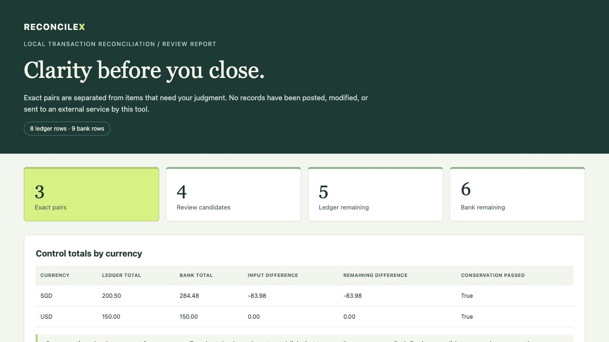

# ReconcileX

**Compare two transaction CSV exports locally. Accept exact, unambiguous pairs and inspect everything else.**

Finance teams often compare ledger and bank exports with spreadsheet lookups. Repeated amounts, date offsets, and inconsistent references make a plausible pairing easy to mistake for a reliable one. ReconcileX produces a portable review report with explicit rules and control totals.

- Integer money arithmetic, with explicit currency precision and no FX conversion.
- Configurable CSV columns, encoding, date format, sign convention, and tolerances.
- One-to-one matches only when both sides have exactly one eligible candidate.
- Ambiguities, duplicate content, zero amounts, and tolerated amount differences remain for review.
- HTML, CSV, and JSON outputs, source fingerprints, and export checksums.
- Python 3.11+, no runtime dependencies, no network access or API credentials required by the tool.

## Try the demo

```bash
git clone https://github.com/CecilyHere/reconcilex.git
cd reconcilex
python -m venv .venv
# macOS/Linux
source .venv/bin/activate
# Windows PowerShell: .venv\Scripts\Activate.ps1
python -m pip install .
reconcilex demo --out reports/demo
```

Open `reports/demo/report.html` in your browser. The report contains **3 accepted pairs, 4 review candidates, 5 remaining ledger rows, and 6 remaining bank rows** from synthetic data. Review candidates can share rows; their count is not the number of unresolved transactions.

The committed [example report](examples/output/report.html) is the actual generated HTML. Download/open it locally to view it; GitHub's source view does not render it as a website. [Sample inputs](examples) and [expected counts](examples/expected.json) let you reproduce the demonstration.



## Reconcile your own exports

```bash
reconcilex reconcile ledger.csv bank.csv --config config.json --out reports/january
```

Each source needs these four columns by default:

```csv
id,date,amount,currency
T001,2026-01-05,100.00,SGD
T002,2026-01-06,-25.50,SGD
```

`reference` and `description` are optional. IDs must be unique within each source; the two sources may use different IDs. Required values must be nonblank. Extra columns are ignored. Amounts are signed plain decimal text, without currency symbols, grouping separators, or exponents. Do not use floating-point preprocessing that changes the original monetary value.

Default dates use `YYYY-MM-DD`. Default encoding is UTF-8 with optional BOM. No date, encoding, sign, or decimal locale is guessed. Positive and negative entries must represent the same economic direction in both inputs. Use a source sign multiplier of `-1` when an export uses the opposite convention.

An example `config.json`:

```json
{
  "ledger": {
    "id": "Entry ID",
    "date": "Posting Date",
    "amount": "Net Amount",
    "currency": "Currency",
    "reference": "Reference",
    "description": "Narrative"
  },
  "bank": {
    "id": "Transaction ID",
    "date": "Value Date",
    "amount": "Amount",
    "currency": "Currency",
    "date_format": "%d/%m/%Y",
    "encoding": "utf-8-sig",
    "delimiter": ",",
    "sign": -1
  },
  "date_window_days": 3,
  "amount_tolerance": "0.05"
}
```

Omit `--config` to use the default column names, zero amount tolerance, and a three-day date window. Configuration keys are validated; unknown or duplicate JSON keys fail. `amount_tolerance` must be a string, not a JSON floating-point number. A tolerance must be representable in every currency present: use `"0"` for JPY instead of `"0.01"`.

Built-in precision: SGD, USD, EUR, GBP, AUD, and CAD use 2 decimals; JPY uses 0; KWD uses 3. To support another currency, set `currency_precision`, for example `{"SGD": 2, "CHF": 2}`. This setting **replaces** the supported set, so list every currency used by your inputs. Scales from 0 to 6 are accepted. Extra fractional digits are rejected, even trailing zeros; amounts are never rounded silently.

## How matching works

1. A pair must have the same currency and sign, be within the configured date window (inclusive), and differ by at most the amount tolerance.
2. If both references are present, they must agree after trimming and case folding. Punctuation is preserved. Missing references do not block an otherwise eligible pair.
3. The complete candidate graph is considered before accepting anything. An exact, nonzero pair is accepted only if each side has exactly one eligible candidate and neither row has duplicate content.
4. Every other eligible pair is a review suggestion. Conflicting references and pairs outside the limits are excluded. Unpaired rows are exported as remaining transactions.

There is no greedy tie-breaking, fuzzy scoring, or claim that a unique candidate proves economic identity. Broad date windows, missing references, or incorrect signs can still produce an economically wrong unique candidate. Review the policy and the underlying source records before relying on the result. Many-to-one or partial settlements are outside v1.0.0.

Duplicate content means the same date, amount, currency, case-folded reference, and case-folded description within one source. Such rows are retained and flagged, not deleted. Legitimate repeated amounts with different descriptions are still subject to candidate ambiguity.

## Outputs and audit trail

| File | Purpose |
| --- | --- |
| `report.html` | Local review report; first 200 rows per section shown |
| `matches.csv` | Accepted exact pairs, rule, dates, references, and source row numbers |
| `review_candidates.csv` | Candidate pairs and reasons requiring review |
| `remaining_ledger.csv` | Ledger rows not accepted into pairs |
| `remaining_bank.csv` | Bank rows not accepted into pairs |
| `result.json` | Complete results, raw text, warnings, configuration, version, timestamps, and input hashes |
| `manifest.json` | SHA-256 checksums of the six other generated files |

For each source, every row appears exactly once in accepted pairs or remaining rows. Candidate exports can refer to remaining rows multiple times. Source row numbers refer to the last physical CSV line of a record, including multiline records. Amount differences use ledger minus bank. Control totals are independent per currency:

`input difference = matched difference + remaining difference`

Conservation accounts for all values; it does not mean every item has been reconciled. The tool never combines different currencies into one total. Input hashes identify the exact bytes consumed. Export checksums are integrity aids when compared with a trusted copy, not signatures or tamper-proof evidence.

All output directories must be new: existing files, directories, and symlinks are refused. Inputs are never modified. A handled write failure removes the new partial directory; a killed process or machine failure can leave partial files. The CLI returns 0 for a completed report, 2 for usage/validation/filesystem failures, and 3 when `--fail-on-unresolved` is selected and unresolved rows exist. Exit code 0 alone does not mean a fully reconciled dataset.

```bash
reconcilex reconcile ledger.csv bank.csv --out reports/check --fail-on-unresolved
```

HTML escapes input text and has no scripts or external resources. CSV exports prefix formula-leading text with an apostrophe; numeric amounts remain numeric. JSON preserves original strings. Spreadsheet applications and re-saving can change protections, so inspect exports and use safe import settings. Reports contain financial data: store and share them with appropriate access controls. [OWASP's CSV guidance](https://owasp.org/www-community/attacks/CSV_Injection) explains this risk.

## Python API

```python
from reconcilex import load_settings, load_csv, reconcile, write_report

settings = load_settings("config.json")
ledger = load_csv("ledger.csv", settings.ledger, settings)
bank = load_csv("bank.csv", settings.bank, settings)
result = reconcile(ledger, bank, settings)
write_report(result, "reports/api-run")
```

Use `load_csv` for validation rather than constructing internal transaction records from unvalidated objects. [Architecture](docs/architecture.md) and [PRD](docs/PRD.md) describe the design and release requirements.

## Tests and packaging

```bash
python -m unittest discover -s tests -v
python -m pip check
# Optional distribution build tools; not runtime dependencies:
python -m pip install -r requirements-dev.txt
python -m build --no-isolation
```

Run tests after installing the package, or use `PYTHONPATH=src python -m unittest discover -s tests -v` from the repository on macOS/Linux. Tests include real CLI subprocesses, 150 seeded randomized graph comparisons, row-partition and currency-conservation checks, malformed inputs, output safety, and failure handling. The dependency-free `unittest` framework keeps the test path reproducible without extra packages. See [validation results](docs/validation.md) for executed checks and their limits.

## Limits and roadmap

Default limits: 10 MiB per input; 50,000 rows per source; 100,000 candidate edges; 2,000,000 amount-range comparisons. The limits are configurable safeguards. Dense equal-amount inputs can reach the comparison limit before the row limit; split exports into smaller periods. Supported date windows are 0–366 days. Monetary values permit at most 18 whole digits and the currency's declared fractional precision.

No XLSX/PDF input, bank connectors, FX conversion, batch/partial matching, persistent manual approvals, or automated accounting entries. This release has synthetic-data validation; no production adoption, benchmark against user workloads, or time-savings claim is made.

Next priorities are real issue reports, sanitized user fixtures, mapping usability, and review workflow feedback. Batch matching requires a separate PRD and correctness tests. There is no commitment to create another product next month.

## Contributing and license

Use synthetic or appropriately licensed sanitized examples when reporting an issue. Never upload bank statements, credentials, or confidential employer/customer data. See [CONTRIBUTING.md](CONTRIBUTING.md) and [SECURITY.md](SECURITY.md).

MIT licensed. See [LICENSE](LICENSE). Created by Cecily Chen as part of a Finance × FinTech × Data open-source portfolio.
